# farfarfun 品牌标识

六个组织共用一套标识系统。核心图形是 **`ff` 连字**——两个 f 共享一道横杠，笔画在底部
连成微笑弧：`ff` 取自 **far far**，底部的弧线是 **fun**。

主组织用纯 `ff`，五个子组织沿用同一个 `ff`，只在右下角挂一枚角标区分产品线。
这样六个头像排在一起能看出是一家，单独拿出来又各有身份。

下面是 **7 个候选方案**，还没有定稿，挑一个即可。

---

## 一、先选方案：同一个主组织的 7 种画法

<table>
<tr>
<td align="center"><br><b>v1</b> 单笔连字</td>
<td align="center"><br><b>v2</b> 纯字母式</td>
<td align="center">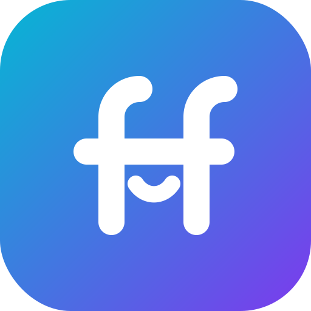<br><b>v3</b> 表情版</td>
<td align="center"><br><b>v4</b> 反白</td>
</tr>
<tr>
<td align="center">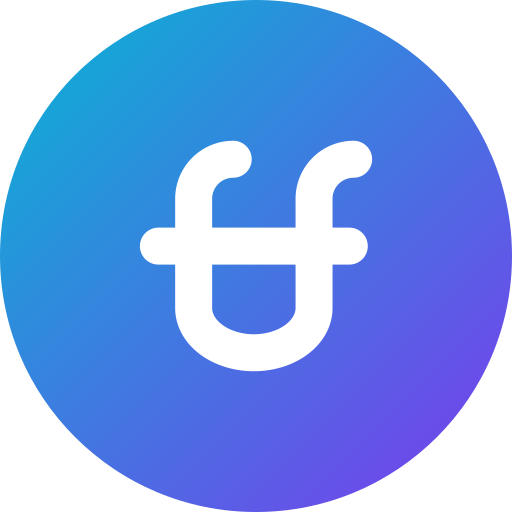<br><b>v5</b> 圆形容器</td>
<td align="center">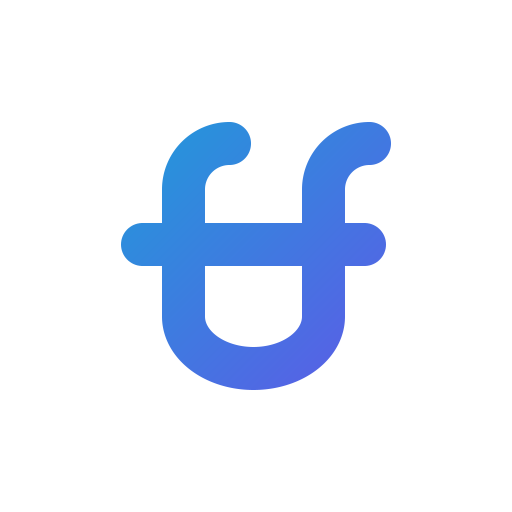<br><b>v6</b> 无容器</td>
<td align="center"><br><b>v7</b> 三连 chevron</td>
<td></td>
</tr>
</table>

| 方案 | 说明 |
|------|------|
| **v1 单笔连字** | 一笔画完 `ff` 与底部笑弧，再加一道共享横杠。结构最简，寓意最完整，**推荐作为主形** |
| **v2 纯字母式** | 两个规规矩矩的 f 共享横杠，不加修饰。最克制，像一个字体厂牌 |
| **v3 表情版** | 在 v2 的两道竖画之间嵌一道小笑弧，顶钩顺势成了眉毛。最外向的一版 |
| **v4 反白** | v1 的浅底版本。深色页眉、贴纸、印刷物上用 |
| **v5 圆形容器** | v1 放进正圆。头像被裁成圆形的平台上不会切角 |
| **v6 无容器** | 透明底的纯图形。README 页眉、favicon、水印用 |
| **v7 三连 chevron** | 备选概念，不是 `ff`：`far·far·fun` 三个词对应三个尖角，同时是 Python REPL 的 `>>>` 提示符 |

> v4 / v5 / v6 是 v1 的同形衍生，定稿后它们会一起作为配套格式保留；真正需要二选一的是
> **v1 / v2 / v3 / v7** 这四种画法。

---

## 二、推荐方案 v1 的全家桶

<table>
<tr>
<td align="center"><br><code>farfarfun</code><br><sub>主组织 · 无角标</sub></td>
<td align="center">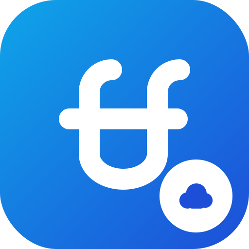<br><code>-drive</code><br><sub>☁ 云 · 网盘</sub></td>
<td align="center">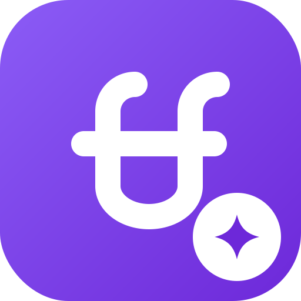<br><code>-skill</code><br><sub>✦ 星芒 · 自研 Skill</sub></td>
</tr>
<tr>
<td align="center"><br><code>-skills</code><br><sub>⧉ 叠层 · 聚合镜像</sub></td>
<td align="center">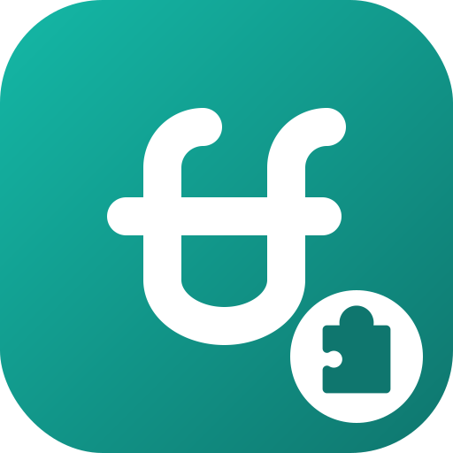<br><code>-utools</code><br><sub>🧩 拼图 · 插件</sub></td>
<td align="center"><br><code>-action</code><br><sub>▶ 播放 · Action</sub></td>
</tr>
</table>

角标的取义：网盘是云，自研 Skill 是从零迸出的星芒，聚合镜像是一摞副本，uTools 是插件，
GitHub Action 是「跑起来」。

---

## 三、其余方案的全家桶

<details>
<summary><b>v2 纯字母式</b></summary>
<p>

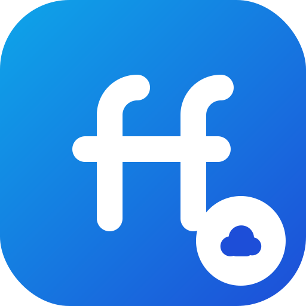
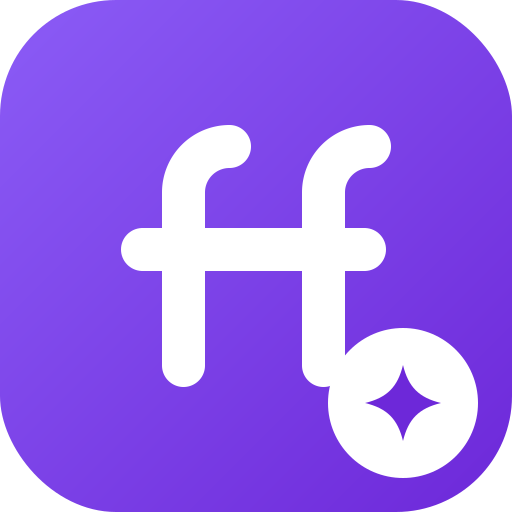

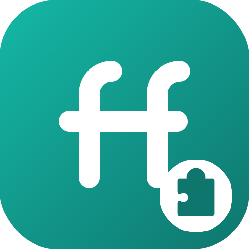

</p>
</details>

<details>
<summary><b>v3 表情版</b></summary>
<p>

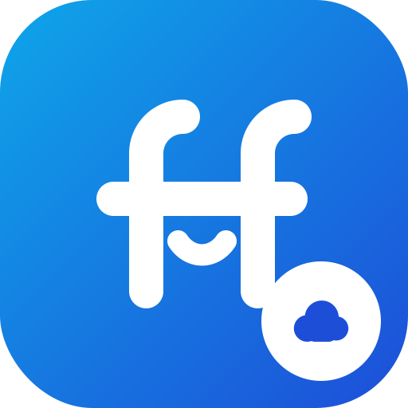
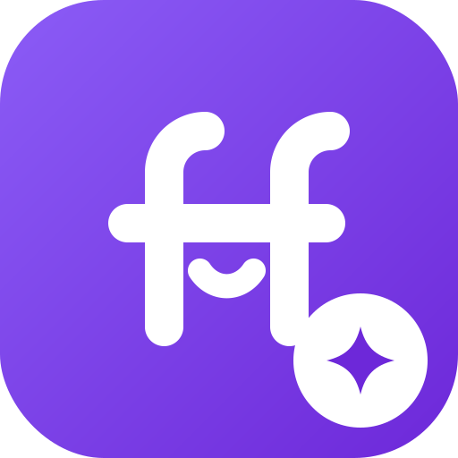

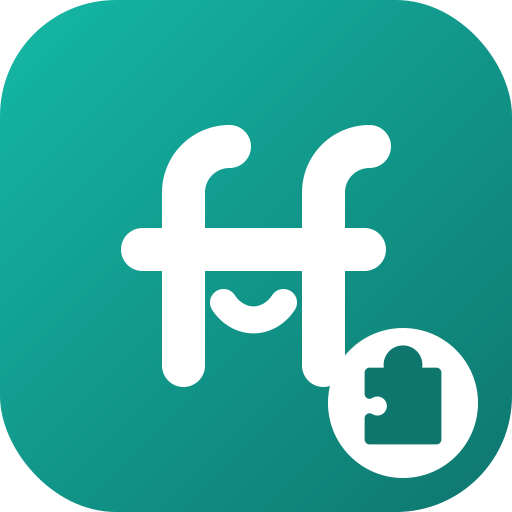

</p>
</details>

<details>
<summary><b>v4 反白</b></summary>
<p>


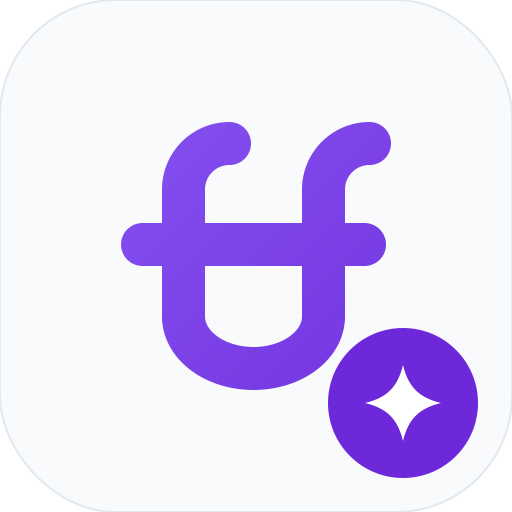

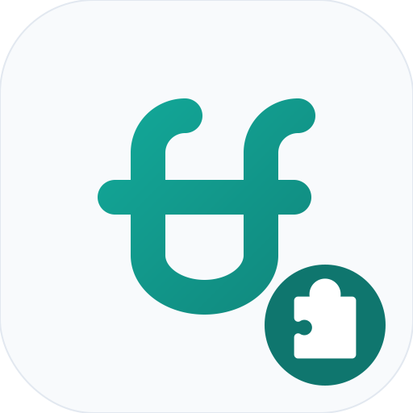

</p>
</details>

<details>
<summary><b>v5 圆形容器</b></summary>
<p>


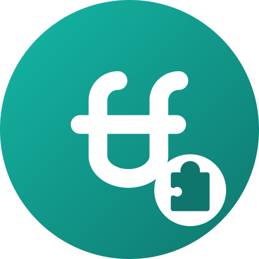

</p>
</details>

<details>
<summary><b>v6 无容器</b></summary>
<p>

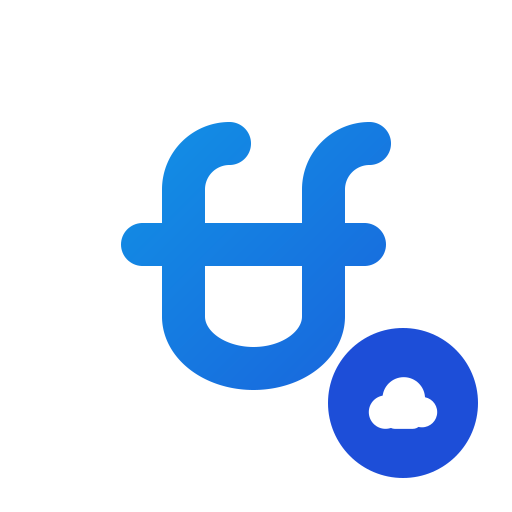
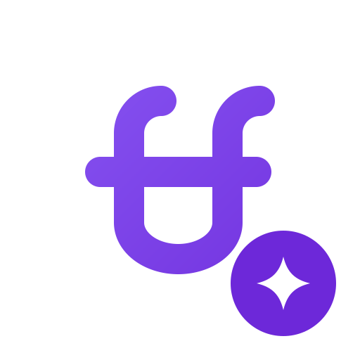

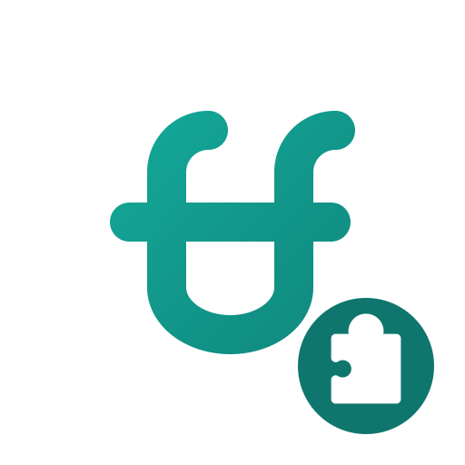
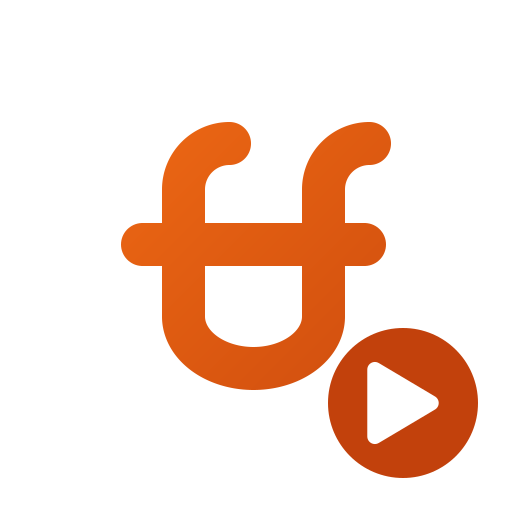
</p>
</details>

<details>
<summary><b>v7 三连 chevron（备选概念）</b></summary>
<p>


</p>
</details>

---

## 四、小尺寸检查

GitHub 的仓库列表、PR 头像、浏览器标签页都在 16–64px 之间。下面是 64px 原始像素，
四种画法都没有糊：

| | farfarfun | drive | skill | skills | utools | action |
|---|---|---|---|---|---|---|
| v1 |  |  |  |  |  |  |
| v2 |  |  |  |  |  |  |
| v3 |  |  |  |  |  |  |
| v7 |  |  |  |  |  |  |

---

## 五、横版组合标

图形 + 组织名，用在 README 页眉和文档封面。深浅两套，分别对应 GitHub 的亮色与暗色主题。

| 浅色底 | 深色底 |
|---|---|
| 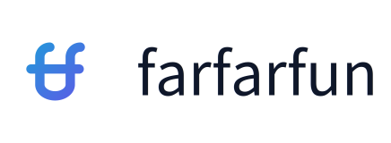 | 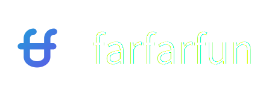 |
| 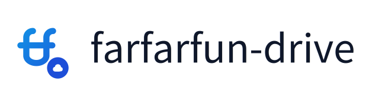 | 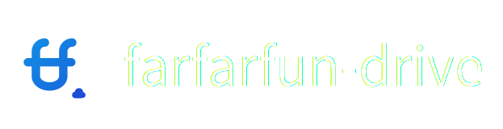 |
|  |  |
|  |  |
|  |  |
|  |  |

> 深色底那一列在 GitHub 亮色主题下看着是白字悬空，属正常——它本来就是放进深色页眉里的。

---

## 六、色板

每个组织一条 135° 的线性渐变，另配一个深色用于角标里的图形。

| 组织 | 渐变起 | 渐变止 | 角标深色 |
|------|--------|--------|----------|
| `farfarfun` | `#06B6D4` | `#7C3AED` | `#6D28D9` |
| `farfarfun-drive` | `#0EA5E9` | `#1D4ED8` | `#1D4ED8` |
| `farfarfun-skill` | `#8B5CF6` | `#6D28D9` | `#6D28D9` |
| `farfarfun-skills` | `#6366F1` | `#4338CA` | `#4338CA` |
| `farfarfun-utools` | `#14B8A6` | `#0F766E` | `#0F766E` |
| `farfarfun-action` | `#F97316` | `#C2410C` | `#C2410C` |

主组织横跨青到紫，子组织各占其中一段色相，排在一起是一条连续的光谱。

---

## 七、文件

```
brand/
├── gen_logos.py          全部图形的唯一来源，改这个文件再重跑
├── svg/<方案>/<组织>.svg   矢量，1024×1024
├── png/<方案>/<组织>-512.png
├── png/<方案>/<组织>-64.png
└── {svg,png}/lockup/      横版组合标，含 -on-dark 版
```

重新生成：

```bash
uv run python brand/gen_logos.py
```

依赖 `cairosvg`（出 PNG）与 `pillow`（量横版组合标的文字宽度）。脚本会先清空
`svg/` 与 `png/` 再整体重建，所以不要往这两个目录里手工放文件。

## 八、定稿之后

1. 选定的方案里，各组织的 512px PNG 直接传作 GitHub 组织头像（GitHub 要求 ≥ 500×500）。
2. 删掉未选中的方案目录，`gen_logos.py` 的 `VARIANTS` 里同步删掉对应项。
3. uTools 插件的 `utools/logo.png` 换成对应组织色的图标。
4. 各仓库 README 页眉换成横版组合标，用 `<picture>` 配 `prefers-color-scheme` 自动切换深浅。
