# farfarfun 品牌标识

七个组织、五个 uTools 插件和 FunClash 共用一套折叠 F 轮廓。主组织图标按
[原版 PNG](farfarfun-original.png) 重新描绘为[完整 SVG](farfarfun-original.svg)，
保留圆角底板、蓝白折叠图形和笑脸。其他主体沿用这枚图标的轮廓、层次与笑脸，
通过上横线的小符号和不同色相表达对应产品。

<table>
<tr>
<td align="center">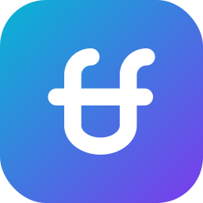<br><code>farfarfun</code><br><sub>原版图形 · 主组织</sub></td>
<td align="center"><br><code>-drive</code><br><sub>云 · 网盘</sub></td>
<td align="center">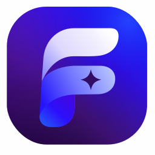<br><code>-skill</code><br><sub>星芒 · 自研 Skill</sub></td>
</tr>
<tr>
<td align="center"><br><code>-skills</code><br><sub>叠层 · 聚合镜像</sub></td>
<td align="center"><br><code>-utools</code><br><sub>拼图 · 插件</sub></td>
<td align="center"><br><code>-action</code><br><sub>播放 · Action</sub></td>
</tr>
<tr>
<td align="center"><br><code>-game</code><br><sub>手柄 · 游戏</sub></td>
</tr>
</table>

上横线的符号分别为云、星芒、叠层、拼图、播放和手柄；笑脸与折叠 F 保持不变。

### uTools 插件

五个插件沿用同一折叠 F 和笑脸，上横线的符号分别为对话、文档、书签、验证和日历。

<table>
<tr>
<td align="center"><br><code>funchat</code><br><sub>气泡 · AI 好友聊天</sub></td>
<td align="center">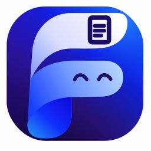<br><code>fundoc</code><br><sub>文稿 · Markdown 文档</sub></td>
<td align="center">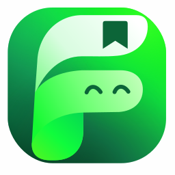<br><code>funlink</code><br><sub>书签 · 网址收藏</sub></td>
<td align="center">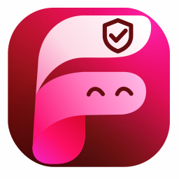<br><code>funotp</code><br><sub>盾 · 两步验证</sub></td>
<td align="center">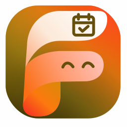<br><code>funcalendar</code><br><sub>日历 · 时光常伴</sub></td>
</tr>
</table>

插件会在 uTools 启动器里并排出现，所以保留彼此区别明显的颜色。FunCalendar 使用琥珀色。
五个插件统一放大折叠 F 和顶部符号；透明 `mark` 的主体占画布高度约 93%，
上下各留约 4% 安全边距，启动器实际使用 256×256 PNG。

### 独立应用

FunClash 也沿用折叠 F 与笑脸，上横线使用 `CLASH` 字标，采用洋红色相。

<table>
<tr>
<td align="center"><br><code>funclash</code><br><sub>CLASH · 代理客户端</sub></td>
</tr>
</table>

完整图标属于 farfarfun 家族造型。

---

## 一、四种格式

四种容器，按场景取用。每组最后一枚是 FunClash。

### icon —— 主图标

渐变圆角方。**组织头像、应用图标、favicon 都用它。**

<p>

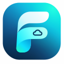


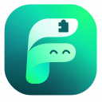


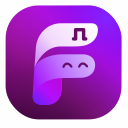
</p>

### icon-inverse —— 反白

浅底配渐变图形。深色页眉、贴纸与印刷物上用。

<p>
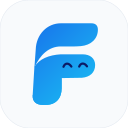


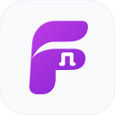
</p>

### icon-circle —— 圆形容器

头像被裁成圆形的平台上不会切角。

<p>


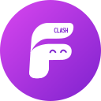
</p>

### mark —— 无容器

透明底的纯图形。README 页眉、文档水印用。

<p>


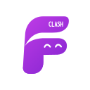
</p>

---

## 二、横版组合标

无容器 `mark` 图形 + 组织名，用在 README 页眉和文档封面。深浅两套，对应 GitHub 的亮色与暗色主题。

| 浅色底 | 深色底 |
|---|---|
|  | 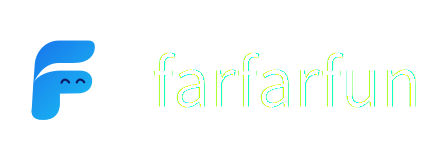 |
|  | 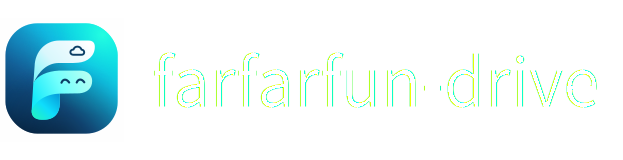 |
|  |  |
|  |  |
|  |  |
|  |  |
|  |  |
|  |  |
|  |  |
|  |  |
|  |  |
|  |  |
| 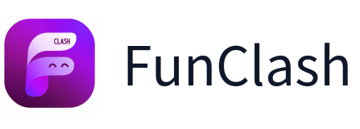 | 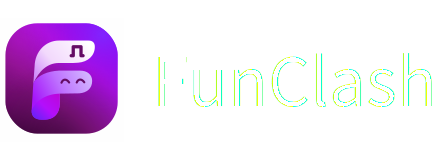 |

> 右列在 GitHub 亮色主题下看着是白字悬空，属正常——它本来就是放进深色页眉里的。

README 页眉按主题自动切换：

```html
<picture>
  <source media="(prefers-color-scheme: dark)"
          srcset="https://raw.githubusercontent.com/farfarfun/.github/master/brand/png/lockup-on-dark/farfarfun-160.png">
  
</picture>
```

---

## 三、尺寸矩阵

| 格式 | SVG | PNG 尺寸 |
|------|-----|----------|
| `icon` | 1024 母版 | 16 · 32 · 48 · 64 · 96 · 128 · 180 · 192 · 256 · 384 · 512 · 1024 |
| `icon-inverse` | 1024 母版 | 64 · 128 · 256 · 512 · 1024 |
| `icon-circle` | 1024 母版 | 64 · 128 · 256 · 512 · 1024 |
| `mark` | 1024 母版 | 32 · 64 · 128 · 256 · 512 · 1024 |
| `lockup` / `lockup-on-dark` | 宽度随组织名变化 | 高 80 · 160 · 320 |
| `favicon/<组织>.ico` | — | 单文件内含 16 · 32 · 48 · 64 · 128 · 256 |

尺寸是按实际用途挑的，不是凑数：

| 尺寸 | 用途 |
|------|------|
| 16 · 32 · 48 | favicon，浏览器标签页与书签栏 |
| 64 · 96 | GitHub 仓库列表、PR 与 issue 里的头像 |
| 128 · 180 | 桌面应用图标、iOS `apple-touch-icon` |
| 192 · 256 | PWA manifest、uTools 插件的 `logo.png` |
| 384 · 512 | GitHub 组织头像（要求 ≥ 500×500） |
| 1024 | 母版，用于再加工与印刷 |

小尺寸图标以折叠 F 与笑脸为主；上横线的符号在大尺寸下提供区分。
FunClash 的字标在小尺寸下以简化笔画呈现。
日常用矢量 SVG 即可，PNG 是给不吃 SVG 的地方准备的。

---

## 四、色板

主图标沿用原版 SVG 的多层渐变，其他主体按各自色相调整。简化格式使用下表色板。

| 组织 | 渐变起 | 渐变止 | 单色值 |
|------|--------|--------|----------|
| `farfarfun` | `#1855E8` | `#19C6F4` | `#07133F` |
| `farfarfun-drive` | `#0EA5E9` | `#1D4ED8` | `#1D4ED8` |
| `farfarfun-skill` | `#8B5CF6` | `#6D28D9` | `#6D28D9` |
| `farfarfun-skills` | `#6366F1` | `#4338CA` | `#4338CA` |
| `farfarfun-utools` | `#14B8A6` | `#0F766E` | `#0F766E` |
| `farfarfun-action` | `#F97316` | `#C2410C` | `#C2410C` |
| `farfarfun-game` | `#84CC16` | `#4D7C0F` | `#4D7C0F` |

主组织的表中颜色用于简化格式，主图标以原版 SVG 为准。子组织沿用轮廓，使用不同色相。

插件另起一组色板，便于在 uTools 启动器中辨认：

| 插件 | 渐变起 | 渐变止 | 单色值 |
|------|--------|--------|----------|
| `funchat` | `#06B6D4` | `#0E7490` | `#0E7490` |
| `fundoc` | `#4F46E5` | `#3730A3` | `#3730A3` |
| `funlink` | `#22C55E` | `#15803D` | `#15803D` |
| `funotp` | `#F43F5E` | `#BE123C` | `#BE123C` |
| `funcalendar` | `#F59E0B` | `#B45309` | `#B45309` |

独立应用使用另一组色相，造型仍属同一家族：

| 应用 | 渐变起 | 渐变止 | 深色 |
|------|--------|--------|------|
| `funclash` | `#D946EF` | `#7E22CE` | `#7E22CE` |

单色值可用于 Android 快捷方式底色、PWA `theme_color` 等只接受纯色的地方。

---

## 五、文件

文件名里的 `<主体>` 是七个组织之一（`farfarfun` `drive` `skill` `skills` `utools`
`action` `game`）、五个插件之一（`funchat` `fundoc` `funlink` `funotp` `funcalendar`），或独立应用
`funclash`，共十三个，每个都出齐下面所有格式与尺寸。

```
brand/
├── farfarfun-original.svg        主组织图形的完整矢量源，1254×1254
├── gen_logos.py                  家族变体与导出的来源
├── svg/<格式>/<主体>.svg          矢量母版；主组织 icon 为 1254×1254
├── png/<格式>/<主体>-<尺寸>.png
├── png/lockup{,-on-dark}/<主体>-<高>.png
└── favicon/<主体>.ico             多尺寸合一
```

重新生成：

```bash
uv run python brand/gen_logos.py
```

依赖 `cairosvg`（出 PNG）与 `pillow`（量组合标文字宽度、打包 `.ico`）。脚本每次会先清空
`svg/` `png/` `favicon/` 再整体重建，**不要往这三个目录里手工放文件**。
主组织图形修改 `farfarfun-original.svg`；其他主体的色相、上横线符号和格式修改 `gen_logos.py`。

---

## 六、落地情况

本仓库的 SVG、PNG、ICO 和横版组合标已按家族造型重新生成；FunClash 已同步透明底主图标与 `CLASH` 字标。

- [x] uTools 五个插件的 `utools/logo.png` 已同步透明底 `mark` PNG
      （funchat 的 `public/logo.png`、funcalendar 的 `utools/logo.svg` 也已同步；
      funcalendar 的 favicon 引用同一 PNG）
- [x] funotp 的 favicon 已改用家族图标
- [x] 七个组织的主页均使用 `mark` 版 PNG 横版组合标
- [x] 五个插件 README 加上图标页眉
- [ ] **七个组织的 GitHub 头像**——只能手工传，REST API 没有组织头像的端点
      （`PATCH /orgs/{org}` 的参数里没有任何 avatar 字段）。到
      `https://github.com/organizations/<组织>/settings/profile` 上传对应的
      `png/icon/<主体>-512.png`。
- [ ] 真正的 Web 项目接入 `favicon/<主体>.ico`（插件走的是内联 SVG 和 logo.png，
      用不上 ico）
- [x] funclash 的桌面、Web、Android 启动器、TV 横幅和 favicon 已同步家族图标；
      托盘与通知栏继续使用适合极小尺寸的简化 F。PWA maskable 图标由 funclash
      仓库基于无容器图形生成满版背景
